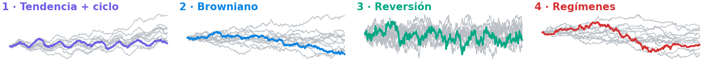
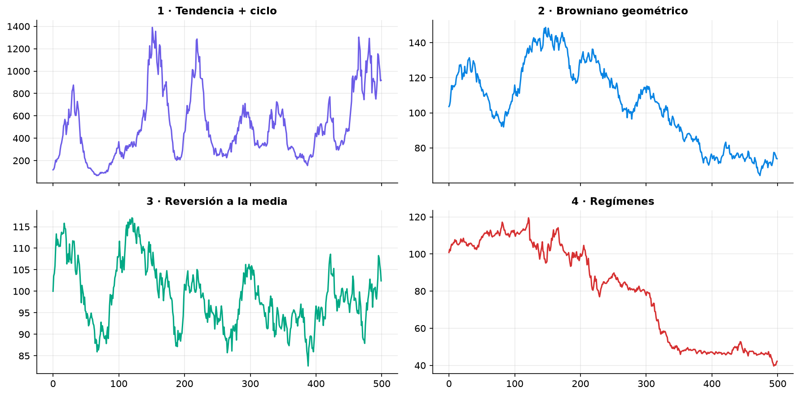
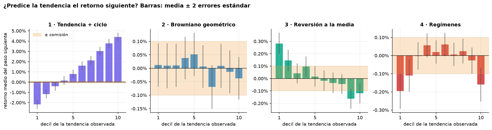
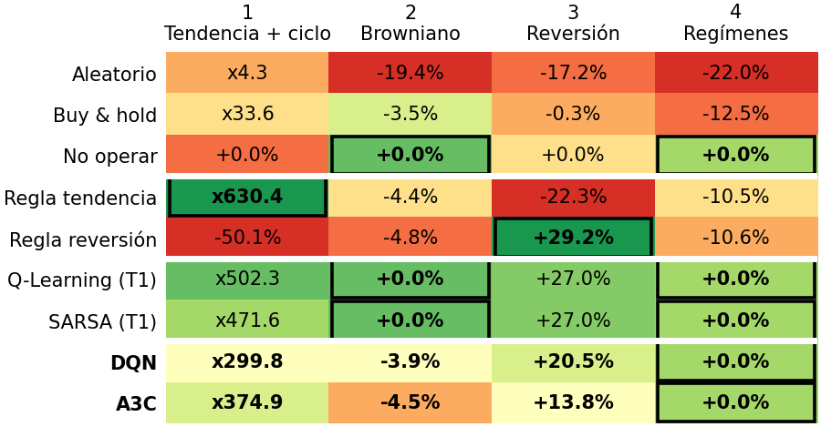
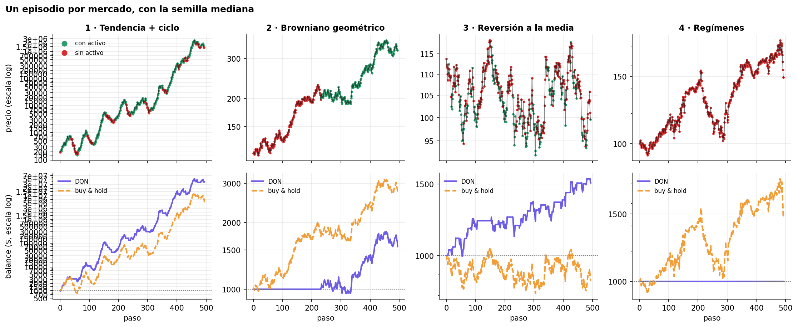
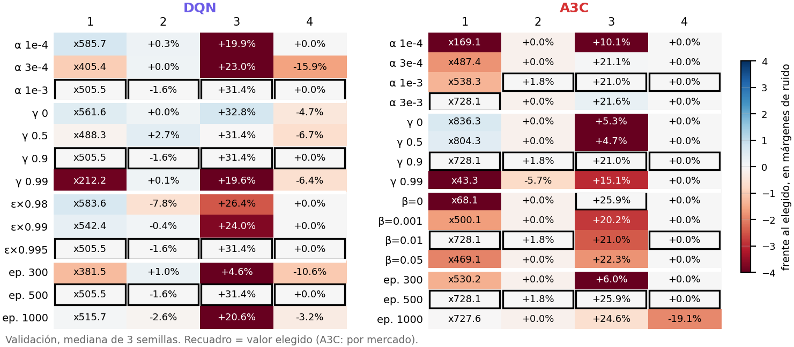
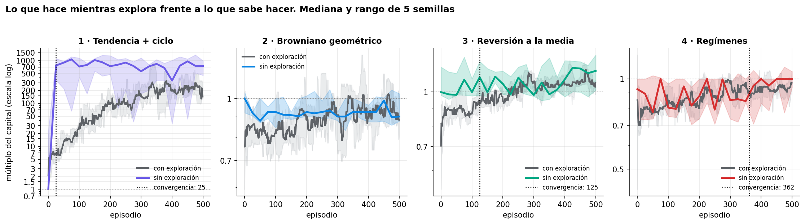
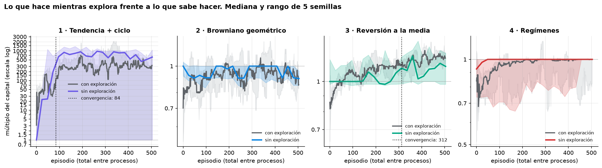
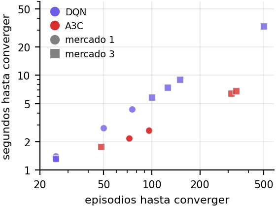
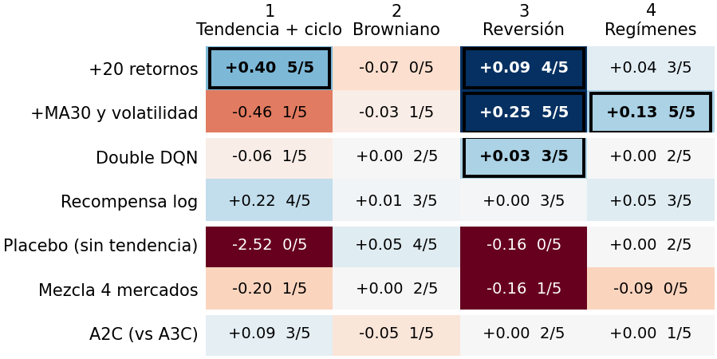

<!-- Fuente del informe (D-0.5). Cifras de results/*.csv y notebooks/04_comparativa.ipynb.
     PDF: python results/build_informe.py --png -->

# Agentes de Deep RL para trading de un activo

Óscar Romero Quincoces · Fernando Dapena Tauste · Daniel García López · Máster MIAX · Aprendizaje por Refuerzo · Noviembre 2026

{.banner}

## 1. Diseño experimental

<b>Fig. 1.</b> 30 series de 500 precios por generador e histograma de retornos.

**Entorno** del enunciado sin cambios: estado `(tendencia, posición)`, acciones vender / mantener / comprar, comisión 0,1 % y recompensa = variación del precio con posición menos costes. Cada episodio usa una **serie nueva**; validación en 100 series y **test en 200, evaluadas una sola vez** con la política greedy y 5 semillas, las mismas que el Taller 1 para comparar con Q-Learning y SARSA (D-0.1).

- **Redes (PyTorch, D-0.2).** Lo más simples posible: entrada `[tendencia/σ, posición]` → 64 ReLU. **DQN:** 3 valores Q, memoria de 20 000 transiciones, lote 128, un paso cada 4 y red objetivo cada 500. **A3C:** 3 procesos asíncronos sobre pesos y Adam compartidos, `t_max` = 20, mismo número de pasos de entorno que DQN.
- **Normalización (D-1.1).** La tendencia y la recompensa se dividen por su σ de train. Sin ella el mercado de reversión no opera (+2,3 % frente a +31,4 % en validación).

- **Métricas.** Mediana del retorno (robusta al x1000 del mercado 1); además Sharpe, drawdown y operaciones. **Convergencia:** primer episodio que recorre el 90 % del camino en la curva greedy de validación (D-0.3).
- **Ajuste por etapas con margen de ruido (D-2.3).** Un parámetro cada vez; un valor solo cambia si mejora más que ~2 errores estándar (25 % del múltiplo en 1; 2 puntos en 3; 10 en 2 y 4). Así no se elige el azar en los mercados sin señal.

<b>Fig. 2.</b> Retorno siguiente por decil de tendencia.

**Estrategia esperada:** seguir la tendencia en 1, comprar caídas en 3 y **no operar** en 2 y 4, donde la señal no cubre la comisión. Por eso añadimos **no operar** y dos **reglas de un umbral** como referencia: son el listón real.

## 2. Resultados por mercado

<b>Fig. 3.</b> Mediana del retorno en test (200 series; DQN y A3C, mediana de 5 semillas). Recuadro = mejor del mercado.

- **Ningún agente deep RL gana en ningún mercado.** Gana una regla simple (x630,4; +29,2 %) o no operar (0 %).
- Donde hay señal **baten con claridad a buy & hold** (x33,6; −0,3 %) y al aleatorio.
- **Q-Learning del Taller 1 queda por encima** (x502,3; +27,0 %): con 2 variables discretizar basta.

<b>Fig. 4.</b> Un episodio de test por mercado: posición del DQN y balance frente a buy & hold.

**¿Es la estrategia esperada?** **1:** sí, sigue la tendencia, aunque opera de más (44 operaciones). **3:** sí, compra tras caídas y vende tras subidas. **2:** no; entra y se queda (como buy & hold, −3,9 %). **4:** no opera (0 %), lo correcto frente a −12,5 % de buy & hold. A3C aprende lo mismo y no opera en las 5 semillas del 4.

## 3. DQN frente a A3C

<b>Fig. 5.</b> Validación de cada valor probado; recuadro = elegido.

**DQN:** α = 10⁻³, γ = 0,9, ε 1 → ×0,995 por episodio, 500 episodios. **Ningún cambio supera el margen**; γ = 0,99 es claramente peor (x212). **A3C:** ε no existe (política estocástica), se ajusta la entropía β. Solo superan el margen α = 0,003 en 1 (x538 → x728) y β = 0 en 3 (+21,0 → +25,9 %); γ = 0,99 hunde el 1 a x43.

<b>Fig. 6.</b> Curva con exploración frente a greedy en validación (mediana y rango de 5 semillas): DQN arriba, A3C abajo.

| Mercado 1 · 3 | DQN | A3C |
|---|---:|---:|
| Test (mediana) | x299,8 · **+20,5 %** | **x374,9** · +13,8 % |
| Convergen | **5/5 · 5/5** | 4/5 · 3/5 |
| Episodios | **25 · 125** | 84 · 312 |
| Segundos | **1,4** · 7,5 | 2,4 · **6,4** |
| Entreno total | 33,0 s | **9,9 s** |

<b>Fig. 7.</b> Episodios frente a segundos hasta converger, por semilla.

**Lectura:** rendimiento **empatado** (en 1 la diferencia es del orden del margen; DQN gana en 3). A3C es **x3,4 más rápido por episodio**, pero DQN converge en menos episodios y en todas las semillas: **hasta converger tardan lo mismo**.

## 4. Más allá de los mínimos

<b>Fig. 8.</b> Ventaja log emparejada frente al DQN base en 400 series nuevas; recuadro = supera el margen. Posterior al test: no sustituye al resultado oficial (D-2.4).

- **Lo que ve el agente pesa más que el algoritmo:** añadir 20 retornos lleva el 1 de x348 a x548; MA30 + volatilidad, el 3 de +16,8 a +47,9 % y el 4 a +7,6 %.
- Double DQN solo mejora en 3; **dueling, quitar la red objetivo o recortar la recompensa, nada**. A2C no mejora a A3C.
- **Placebo** sin tendencia: solo compra y mantiene. **Comisión 0,5 %:** de 69 a 1 operación en 3.
- **S&P 500** (train 2017–21, test 2024–25): +12,1 % frente a +43,8 % de buy & hold.

## 5. Análisis crítico y conclusiones

**Limitaciones**

- **Estado de 2 variables:** limita más que el algoritmo; con él una tabla basta y la red no aporta.
- **5 semillas y márgenes descriptivos**, no tests de significación. La dispersión es grande (DQN x228–x558 en 1).
- **El test ya se había visto** al probar mejoras: las cifras de §4 y los «mejores puntos» se miden aparte, en series nuevas.
- **Mercados sintéticos** y un S&P 500 de una sola trayectoria, sin spread ni deslizamiento.
- A3C no es reproducible bit a bit; los tiempos solo se comparan en el mismo equipo.

**Conclusiones**

1. DQN y A3C **aprenden la estrategia esperada** donde hay señal (1 y 3) y **no operan** en 4; fallan en el browniano.
2. **No superan a reglas de un umbral ni a los tabulares**: el problema es demasiado simple para la red.
3. **DQN ≈ A3C** en rendimiento; A3C entrena más rápido, DQN converge en menos episodios y con menos varianza.
4. El ajuste apenas importa salvo γ y normalizar; **lo que más mejora es enriquecer el estado**.
5. Quedarse con el mejor punto de validación (x480,3 y +30,1 % en A3C) es la mejora más prometedora a confirmar.

